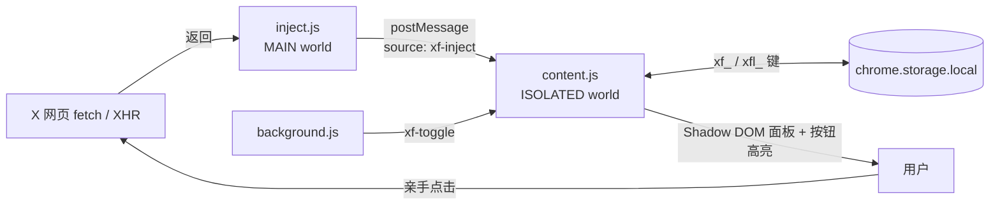

# 设计文档：X 关注管理

## 概述

三个脚本分工，数据单向流动：



## 组件

### inject.js

- 在 `document_start` 包装 `window.fetch` 和 `XMLHttpRequest`，只匹配 `API_RE`（GraphQL 和 friendships create/destroy）。
- 用 `response.clone()` 读取返回，不改变网页拿到的结果。
- `extract(json)` 输出 `list`（列表本身的条目，保持顺序）和 `others`（返回中出现的其它用户）。
- 消息按 `kind` 区分：`users`（列表数据）、`action`（用户自己的关注 / 取关）、`apierr`（非 2xx，带状态码和 `x-rate-limit-reset`）、`sample`（调试用的返回样本）。

**为什么必须在 MAIN world：** ISOLATED world 看不到网页的 `fetch`，只有 MAIN world 能旁听网页自己的请求。

### content.js

- **存储层**：`S` 为当前账号的状态对象，`save()` 防抖写入；名单单独存到 `xfl_` 键，用 `writer` token 区分自己和其它标签页的写入。
- **合并**：`onUsers` 按列表类型（Following / Followers）更新 `following`、`followedBy`、`lastSeenInList`；`onAction` 处理用户自己的关注 / 取关；`onApiErr` 在 429 时暂停引导。
- **扫描**：`S.meta.scan` 记录类型和开始时间；`finishScan` 用 `lastSeenInList < startedAt` 找出已不在列表里的账号。
- **引导**：`S.queue` 持久化队列，刷新后可继续。`tick()` 定时查找目标按钮，`showHL` 画高亮框；检测到状态变化后 `stepDone`。
- **UI**：Shadow DOM 隔离样式；`scheduleRender` 合并多次渲染；表格最多显示 `MAX_ROWS = 1000` 行。

### background.js

只处理扩展图标点击，没有持久状态（MV3 service worker 会被回收）。

## 数据模型

```js
// xf_<我的用户ID>
{
  v: 1,
  writer,                     // 写入方标签页 token
  me: { followers, friends }, // 我的粉丝数 / 关注数
  meta: { installedAt, firstScanDone, scan, lastScan },
  accounts: {                 // 我关注过的人，key 为用户 ID
    [id]: {
      handle, name, avatar, followers, friends, verified, protected,
      following, followedBy,
      followedAt, firstSeenAt, preInstall, lastSeenInList,
      unfollowedAt, requestedAt,
    },
  },
  followers: { [id]: lastSeenAt }, // 粉丝列表扫描结果
  queue: null | { type, ids, index, ... },
  ui: { status, rel, min, max, timeMode, days, from, to, q, sort, list },
}

// xfl_<我的用户ID>
{ writer, white: { [id]: true }, black: { [id]: time } }
```

## 错误处理

| 情况 | 处理 |
|---|---|
| 返回结构无法识别 | 忽略，不发消息 |
| 未登录（没有 `twid` cookie） | 不加载数据，面板提示登录 |
| 429 限流 | 暂停引导，显示恢复时间；自动滚动 20 秒无数据后停止 |
| 主页显示错误页 | 引导识别“重试”按钮，提示用户刷新或跳过 |
| storage 写入失败 | 静默忽略，下次保存重试 |

## 测试策略

- `test/inject.test.js`：在 Node `vm` 里加载 `inject.js`，用假的 `fetch` 返回新旧两种用户结构、分页列表、friendships 返回和 429，断言 `postMessage` 的内容。
- `test/ui.html`：注入模拟数据渲染面板，人工检查布局和交互。
- 真机：Chrome 加载已解压扩展，在 x.com 上完整走一遍扫描 → 筛选 → 引导取关。
